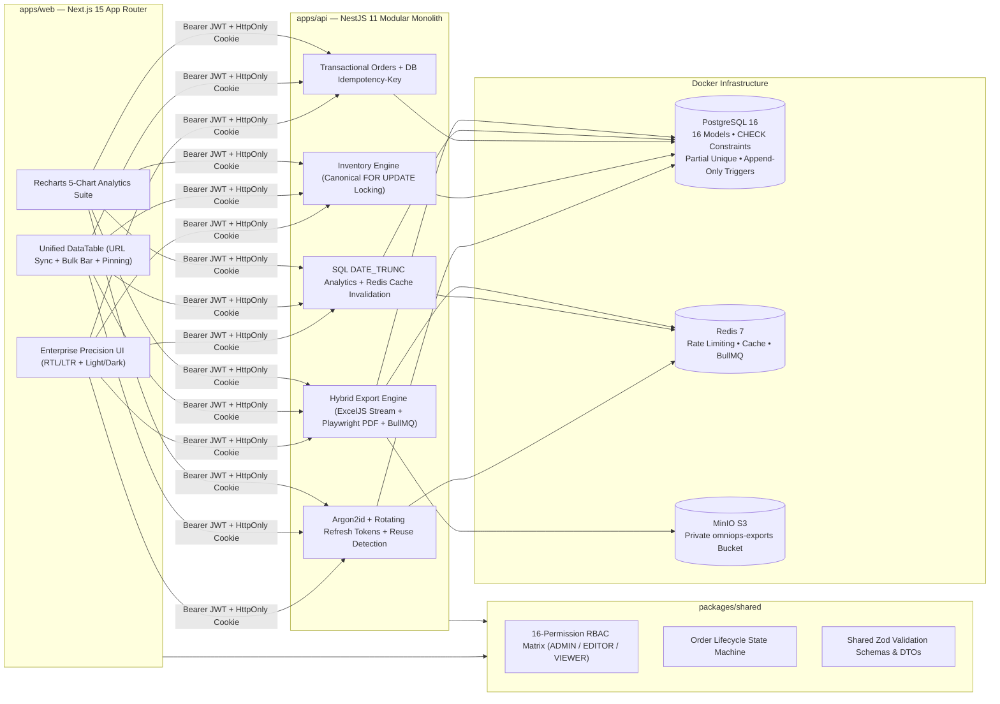

# OmniOps — Enterprise Multi-Warehouse Inventory & Order Operations Dashboard

Production-grade **Multi-Warehouse Inventory Ledger, Transactional Order Operations, Real-Time SQL Analytics, and Hybrid Sync/Async Export Platform** built as a full-stack TypeScript Monorepo (`Turborepo` + `pnpm`).

Designed as an enterprise engineering showcase demonstrating **transactional data integrity**, **deadlock-free concurrency control**, **rotating refresh token reuse detection**, **cursor-paginated immutable ledgers**, and a **bilingual (Arabic RTL / English LTR) Enterprise Precision Design System**.

---

## 1. System Architecture



Detailed architectural documentation is available in [docs/ARCHITECTURE.md](docs/ARCHITECTURE.md) and live PostgreSQL `EXPLAIN ANALYZE` benchmarks are recorded in [docs/BENCHMARKS.md](docs/BENCHMARKS.md).

---

## 2. Core Engineering Highlights

### Database & Concurrency Guarantees (PostgreSQL 16 + Prisma 6)
- **16-Model Relational Schema** (`apps/api/prisma/schema.prisma`): Covers `users`, `refresh_tokens`, `auth_tokens`, `warehouses`, `categories`, `products`, `inventory_levels`, `stock_movements` (with `balance_after`), `customers`, `orders`, `order_items`, `order_status_history`, `idempotency_keys`, `export_jobs`, `notifications`, and `audit_logs`.
- **Storage-Level `CHECK` Constraints**: `quantity_on_hand >= 0`, `quantity_reserved >= 0`, and `quantity_on_hand >= quantity_reserved` on `inventory_levels` guarantee zero overselling even under high concurrency.
- **Deadlock-Free Row Locking**: Multi-item order reservations and inter-warehouse stock transfers acquire `SELECT ... FOR UPDATE` locks in canonical `(product_id ASC, warehouse_id ASC)` order ([inventory-lock.helper.ts](apps/api/src/prisma/inventory-lock.helper.ts)).
- **Transactional `Idempotency-Key`**: Stored inside `idempotency_keys` within the **same database transaction** as order creation ([idempotency.helper.ts](apps/api/src/prisma/idempotency.helper.ts)). Duplicate requests replay the original order; mutated payloads with the same key return `409 Conflict`.
- **True Append-Only Ledgers**: PostgreSQL triggers `trg_stock_movements_immutable` and `trg_audit_logs_immutable` block `UPDATE` and `DELETE` operations on `stock_movements` and `audit_logs`.
- **Partial Unique Indexes & Soft Delete**: `WHERE deleted_at IS NULL` unique indexes on `users(LOWER(email))` and `products(sku)` allow soft-deleted SKUs and emails to be cleanly re-registered.

### Security & RBAC
- **Argon2id + Rotating Refresh Tokens**: Short-lived in-memory JWT access tokens (`15m`) paired with `HttpOnly; SameSite=Strict` refresh token cookies (`7d`).
- **Refresh Token Reuse Detection**: Replaying a rotated refresh token immediately revokes the entire session `family_id` and records a `REFRESH_TOKEN_REUSE_DETECTED` security event in `audit_logs`.
- **16-Permission RBAC Matrix**: Enforced on both NestJS endpoints (`@RequirePermissions(...)`) and Next.js routes/components (`<RoutePermissionGuard>` & `<PermissionGate>`).

### Hybrid Sync/Async Export & PDF Engine
- **Synchronous Streaming (`<= 5,000` rows)**: Constant-memory 1,000-row batch streaming via `ExcelJS.stream.xlsx.WorkbookWriter` or Playwright Chromium PDF generation.
- **Asynchronous BullMQ + MinIO Pipeline (`> 5,000` rows)**: Automatically transitions to `202 Accepted`, processes in a BullMQ worker (`concurrency: 2`), stores the artifact in the private `omniops-exports` MinIO bucket (`24h` retention), emits an `EXPORT_READY` notification, and serves downloads through an ownership-verified endpoint (`GET /api/v1/reports/jobs/:id/download`).

---

## 3. Live PostgreSQL 16 `EXPLAIN (ANALYZE, BUFFERS)` Benchmarks

Tested on the seeded dataset (**500 Products**, **5 Warehouses**, **2,500 Inventory Levels**, **25,003 Orders**, **67,318 Stock Movements**):

| Query Pattern | Execution Time | Index / Plan Strategy |
| :--- | :---: | :--- |
| **Orders by Warehouse + Status (`LIMIT 20`)** | `0.357 ms` | `Index Scan` on `orders_warehouse_id_created_at_idx` |
| **Stock Movements Cursor Ledger (`67,318` rows)** | `0.560 ms` | `Index Scan` on `stock_movements_warehouse_id_created_at_idx` |
| **Active User Email Lookup (`deleted_at IS NULL`)** | `0.077 ms` | `Index Scan` on `idx_users_email_active_unique` |
| **Products Catalog Search (`name / SKU ILIKE`)** | `0.712 ms` | Filtered catalog scan |
| **Low-Stock Warehouse Alert (`Available <= Reorder`)** | `0.478 ms` | `Bitmap Index Scan` on `inventory_levels_warehouse_id_quantity_on_hand_idx` |
| **90-Day Time-Series `DATE_TRUNC` Revenue (`25k` orders)** | `11.233 ms` (SQL) / `~13 ms` (HTTP Redis HIT) | `Bitmap Index Scan` on `orders_created_at_idx` + Redis TTL Cache |

Run the benchmark suite anytime with:
```bash
pnpm db:benchmark
```

---

## 4. Quick Start

```bash
# 1. Start PostgreSQL 16 (port 5433), Redis 7 (port 6379), and MinIO (ports 9000/9001)
pnpm docker:up

# 2. Install dependencies, generate Prisma client & apply migrations
pnpm install
pnpm db:generate
pnpm db:migrate:deploy

# 3. Seed dataset (500 products, 25,000 orders, 67,000+ stock movements, demo accounts)
pnpm db:seed
# Optional fast light seed for CI: SEED_SCALE=light pnpm db:seed

# 4. Build, typecheck, and run automated tests
pnpm build
pnpm typecheck
pnpm test

# 5. Start development servers (Web: http://localhost:3000 | API + Swagger: http://localhost:4000/api/v1/docs)
pnpm dev
```

---

## 5. Portfolio Demo Accounts (`NEXT_PUBLIC_DEMO_MODE=true`)

One-click quick-fill buttons are available on the `/login` screen when `NEXT_PUBLIC_DEMO_MODE=true`:

| Role | Email | Password | Capabilities |
| :--- | :--- | :--- | :--- |
| **Admin** | `admin@omniops.dev` | `OmniOps@2026!` | Full access including order cancellation/refunds, user & warehouse administration, and audit logs |
| **Editor** | `editor@omniops.dev` | `OmniOps@2026!` | Product CRUD, stock adjustments & transfers, order creation & forward fulfillment, exports |
| **Viewer** | `viewer@omniops.dev` | `OmniOps@2026!` | Read-only access to dashboards, catalogs, inventory ledger, orders, analytics, and exports |
