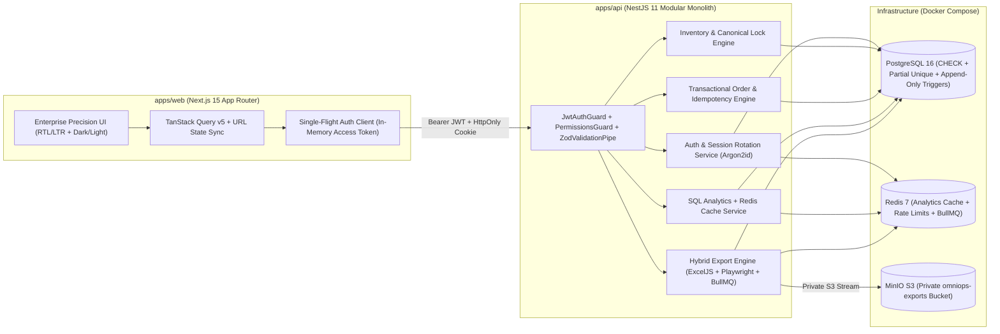

# OmniOps — System Architecture & Engineering Reference

## 1. High-Level System Architecture

---

## 2. Database Integrity & Concurrency Guarantees

| Engineering Guarantee | Implementation Detail |
| :--- | :--- |
| **Zero Overselling / Negative Stock** | PostgreSQL `CHECK` constraints (`quantity_on_hand >= 0`, `quantity_reserved >= 0`, `quantity_on_hand >= quantity_reserved`) enforced at the storage engine level. |
| **Deadlock-Free Multi-Item Locking** | `lockInventoryLevelsOrdered()` deduplicates and sorts `(product_id ASC, warehouse_id ASC)` before issuing `SELECT ... FOR UPDATE`, eliminating circular wait deadlocks across concurrent multi-item orders and bidirectional warehouse transfers. |
| **Exact Inventory Reservation Lifecycle** | `PENDING` / `CONFIRMED` increment `quantity_reserved` only; `SHIPPED` decrements both `quantity_reserved` and `quantity_on_hand` and writes an immutable `OUT` ledger entry; `CANCELLED` before shipment releases `quantity_reserved`; `REFUNDED` after delivery optionally restocks `quantity_on_hand` with an `IN` ledger entry. |
| **Transactional `Idempotency-Key`** | Stored in `idempotency_keys` (`key`, `user_id`, `request_hash`, `response_body`, `status_code`, `expires_at`) **inside the same database transaction** as order creation. Identical retries replay the exact created order; altered payloads with the same key return `409 Conflict`. |
| **True Immutable Ledgers** | PostgreSQL triggers `trg_stock_movements_immutable` and `trg_audit_logs_immutable` reject any `UPDATE` or `DELETE` on `stock_movements` and `audit_logs` even from direct SQL clients. |
| **Soft-Delete + SKU/Email Reuse** | Partial Unique Indexes (`WHERE deleted_at IS NULL`) on `users(LOWER(email))` and `products(sku)` paired with a Prisma Client Extension that automatically filters `deletedAt: null`. |

---

## 3. Authentication, Session Security & RBAC

- **Rotating Refresh Tokens with Reuse Detection**:
  - Access Token (`15m`) kept strictly in browser memory (`api-client.ts`).
  - Refresh Token (`7d`) stored as SHA-256 hash in `refresh_tokens` with `family_id` and `replaced_by_id`, sent in `HttpOnly; SameSite=Strict; Path=/api/v1/auth` cookie.
  - Replaying an already-rotated token revokes the entire `family_id` immediately and writes a `REFRESH_TOKEN_REUSE_DETECTED` security event to `audit_logs`.
- **Single-Flight Client Refresh**: Concurrent `401` responses share a single in-flight `/auth/refresh` promise so React StrictMode or parallel queries never trigger false-positive token reuse errors.
- **Permission-Based RBAC (`packages/shared/src/rbac/permissions.ts`)**:
  - `ADMIN`: All 16 permissions (including `orders:cancel`, `orders:refund`, `products:delete`, `warehouses:manage`, `users:manage`, `audit:read`).
  - `EDITOR`: Operational read/write permissions (`products:write`, `inventory:adjust`, `inventory:transfer`, `orders:write`, `customers:write`, `reports:export`).
  - `VIEWER`: Read-only access across catalogs, orders, analytics, and report exports (`reports:export`).

---

## 4. Hybrid Sync/Async Export Pipeline

1. **Synchronous Streaming (`<= 5,000` rows)**:
   - Streams rows in 1,000-row batches from PostgreSQL directly through `ExcelJS.stream.xlsx.WorkbookWriter` or Playwright Chromium PDF renderer (`X-Export-Mode: sync`).
2. **Asynchronous Background Pipeline (`> 5,000` rows)**:
   - Returns `202 Accepted` (`X-Export-Mode: async`) and enqueues a job in **BullMQ** (`concurrency: 2`).
   - Worker streams the full dataset (e.g., 25,000+ orders), uploads the file to the private **MinIO** bucket `omniops-exports`, sets a 24-hour expiry timestamp, and creates an `EXPORT_READY` notification.
   - Downloads are served through `GET /api/v1/reports/jobs/:id/download`, which verifies JWT authentication, RBAC permission (`reports:export`), job ownership (or `ADMIN` role), and expiration before streaming from MinIO.
   - An automated cleanup cron deletes expired MinIO objects and expired `idempotency_keys`.
